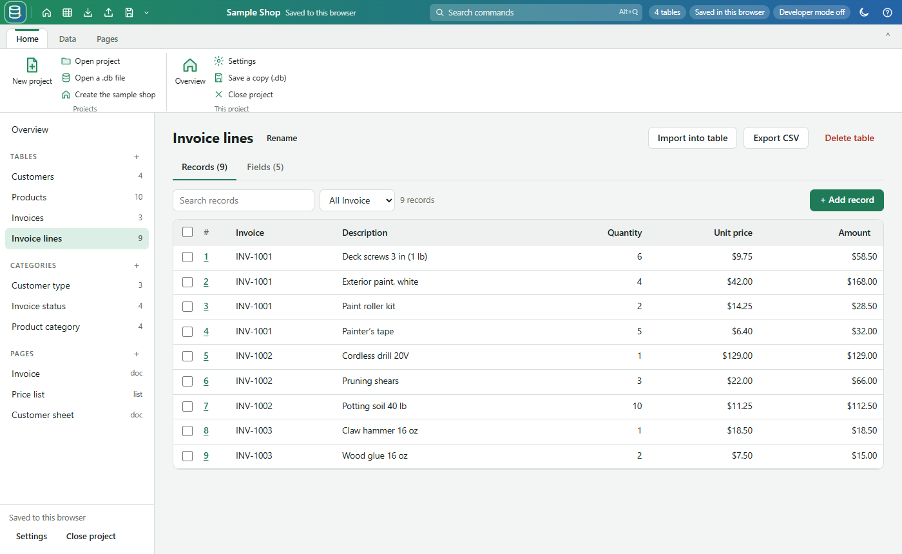
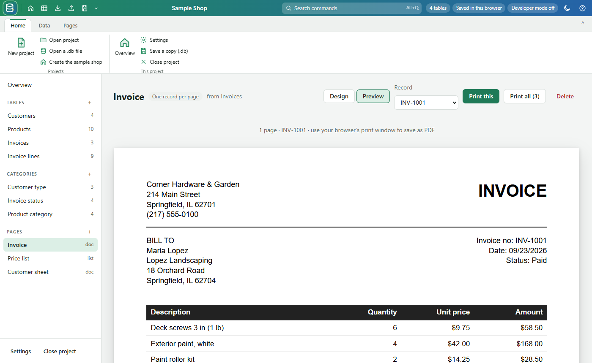

# DataCraft

**A simple database maker in your browser, in the spirit of Microsoft Access and PHPMaker.**

Make tables, import text files, keep category lists, link tables together, and design printable invoices, record sheets and price lists. Each project is a standard SQLite database file on your computer. A developer mode adds MySQL `.sql` export and import, an SQL console, and a PHP website maker for your own web server.

## Getting started

1. Download this repository (green **Code** button › **Download ZIP**) or clone it.
2. Double-click `app/index.html`. It opens in Chrome or Edge.
3. The first time, click **Choose the datacraft folder** and pick the folder that contains `app`, `projects` and `php`. DataCraft saves every project there.
4. Click **Create the sample shop project** to see customers, products, invoices and ready-made pages, or **+ New project** to start your own.

## Finding your way

| Where | What is there |
| --- | --- |
| **DataCraft logo** (top left) | Every command in classic menus: File, Data, Pages, Developer, Help (also F10) |
| **Top bar** | Quick buttons (overview, new table, import, export CSV, save a copy; customize them with ⌄), the project name and save state, **Search commands (Alt+Q)**, tables, where it is saved, developer mode, theme, help |
| **Ribbon tabs** | **Home** (projects), **Data** (tables, categories, import and export), **Pages**, and **Developer** when developer mode is on (MySQL, SQL console, PHP website) |
| **Left side** | Your tables, category lists and pages |

## What it does

### Tables and fields
- Field types: **text, notes (long text), number, money, date, yes/no, category, link to another table, and calculated** (formulas like `[Quantity] * [Unit price]`).
- Search, sort and filter records; filter by category; add, edit and delete records in a grid.
- Pick which field names a record (for example *Invoice no*), so links show something readable.

### Categories
- Keep pick-lists (customer type, product category, status…) under **Categories**.
- Rename a choice and every record using it updates.

### Import text and CSV
- Bring in `.txt`, `.csv` or `.tsv` files, or paste text.
- Works out the separator (comma, tab, semicolon, pipe, space) or **fixed-width** columns, which you can adjust by clicking on a ruler.
- Skips header and footer lines, guesses field types (numbers, money, dates, yes/no), and can turn repeated values into category lists.
- Handles US and European number and date styles, and older Windows text files.
- Keeps a copy of every imported file in the project's `imports` folder.

### Export
- **CSV** for Excel or other programs: choose the columns and separator, and optionally only the records matching your search.

### Pages: invoices, sheets and lists
- **Record pages**: one record per page, such as an invoice or customer sheet.
- **List pages**: many records, such as a price list.
- Text boxes mix fixed text with `{Field}` and `{Link.Field}` placeholders, for example `{Customer.Address}`.
- Tables of related lines (an invoice's items) with **subtotal, tax and total**.
- Grouping, multi-page tables, logos, lines and boxes.
- Special fields: `{Today}`, `{Page}` of `{Pages}`, `{Count}`, `{Subtotal}`, `{Tax}`, `{Total}`.
- US Letter, US Legal or A4, portrait or landscape.
- **Print**, or save as **PDF** from the print window.

### Developer mode
Turn it on with **Help › Turn on developer mode**. A **Developer** menu appears:

- **Export for MySQL (.sql)**: a file for phpMyAdmin or `mysql -u USER -p DATABASE < file.sql` (MySQL 5.7+, MariaDB 10.2+).
  - Category lists go into a `dc_categories` table.
  - Calculated fields become generated columns.
  - Links can become foreign keys.
- **Import a MySQL .sql file**: reads exports from phpMyAdmin, mysqldump or DataCraft.
  - Foreign keys become links, and ENUM columns become category lists.
  - Views, triggers, procedures and binary columns are skipped, and you are told what was left out.
- **SQL console**: run SQLite commands on the open project.
- **Make a PHP website**: writes a small admin site into `php/sites/<site>`, ready for your own server (PHP 7.4+ with PDO MySQL).
  - Log in, then list, search, filter, sort and page through records, add, edit and delete them, download CSV, and jump to linked records (an invoice's lines).
  - Security: PDO prepared statements, CSRF tokens, `password_hash`, lockout after 5 wrong passwords, and a one-time **setup key** for the first account.
  - `config.php` (your database password) and `assets/custom.css` are written once and never replaced.
  - The database file `<site>-database.sql` is saved **next to** the site folder, not in it, so it never gets uploaded by mistake.

The MySQL export and import and the PHP site were tested against MySQL 8.0, MariaDB 11.4 and PHP 8.2.

## Folders

| Folder | What is in it |
| --- | --- |
| `app/` | The program. Updating it never touches your projects. |
| `projects/<name>/<name>.db` | A project: tables, records, categories and page designs. Any SQLite tool (for example DB Browser for SQLite) can open it. |
| `projects/<name>/imports/` | Copies of the files you imported |
| `projects/<name>/exports/` | CSV and `.sql` files you exported |
| `php/sites/<site>/` | A PHP website made by DataCraft (upload this folder) |
| `php/sites/<site>-database.sql` | That site's tables and records, to import with phpMyAdmin (keep it on your computer) |

Your own projects and generated sites are never uploaded to GitHub (see `.gitignore`).

## Requirements

Chrome or Edge (recent versions). Firefox and Safari work too, but keep projects inside the browser instead of a folder: use **File › Save a copy (.db)** to back them up there, and the PHP website maker gives you a `.zip`.

## Credits

- [sql.js](https://github.com/sql-js/sql.js) 1.10.3 (SQLite for the browser, MIT)
- [Papa Parse](https://www.papaparse.com/) 5.4.1 (MIT)

## Development notes

How the app is built, the decisions behind it, and known pitfalls: see [NOTES.md](NOTES.md).
